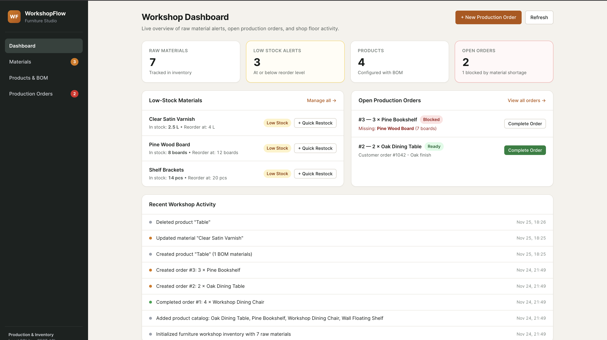
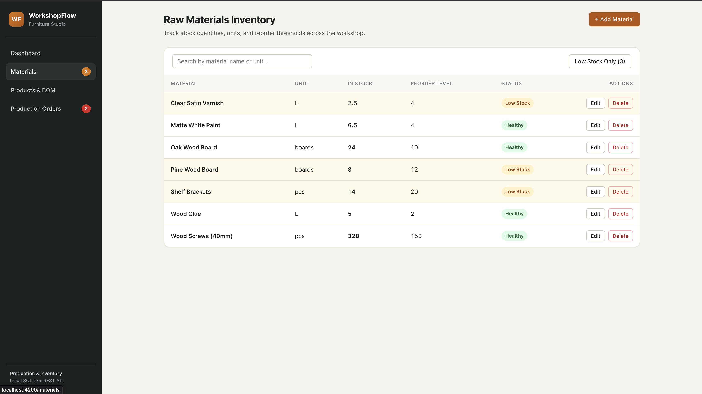
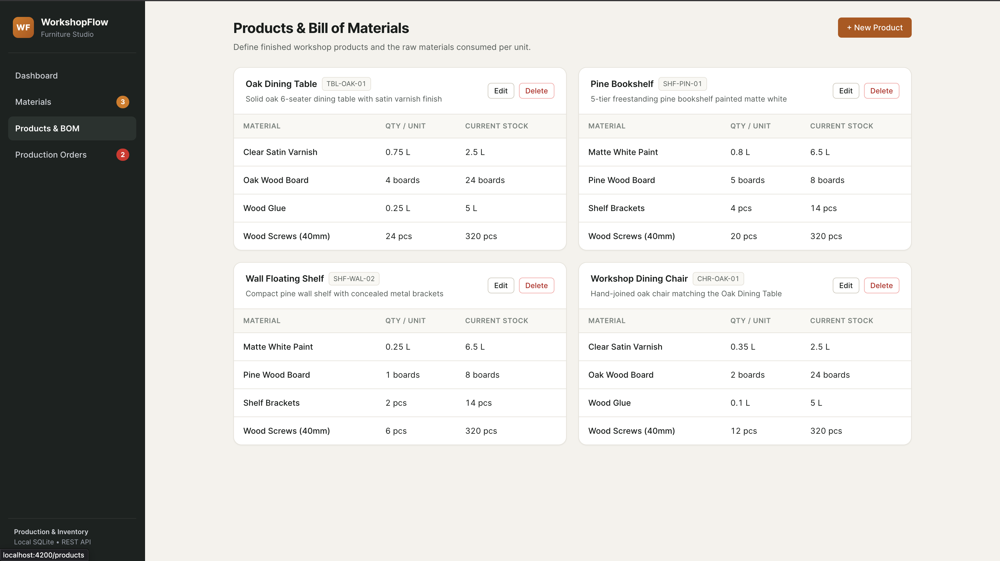
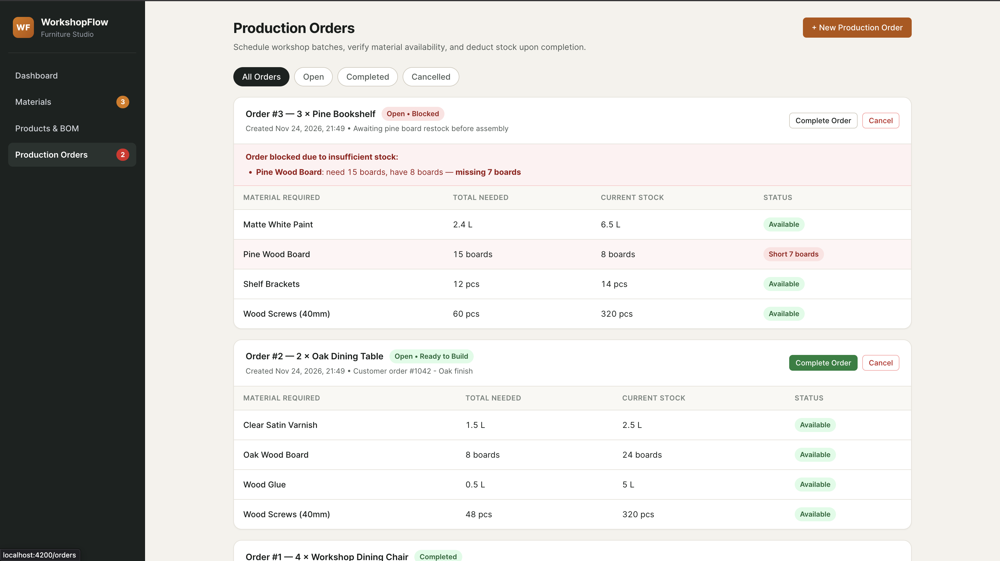

# WorkshopFlow

**WorkshopFlow** is a full-stack production and inventory management web application built for a small manufacturing workshop (pre-seeded for a custom furniture studio). It tracks raw materials, low-stock reorder alerts, product bills of materials (BOM), and production orders with atomic stock deduction and shortage blocking.

---

## Features

- **Dashboard**: Real-time overview of total materials, low-stock alerts (at or below reorder level), open/blocked production orders, quick restock actions, and recent workshop activity.
- **Raw Materials Inventory**: Create, edit, search, filter low-stock items, and delete materials (`name`, `unit`, `stockQuantity`, `reorderLevel`). Prevents deleting materials actively used in a product BOM.
- **Products & Bill of Materials (BOM)**: Define finished products (with optional SKU and description) and the exact raw materials and quantities required per unit.
- **Production Orders**: Create batch orders with a live material requirement preview. Completing an order runs inside a database transaction:
  - If all materials are available, required quantities are subtracted from stock atomically.
  - If any material is short, completion is blocked (`409 Conflict`) and the exact missing materials and quantities are shown.
- **Furniture Workshop Seed Data**: Includes 7 materials (Oak/Pine wood boards, wood screws, shelf brackets, matte white paint, clear satin varnish, wood glue), 4 products (Oak Dining Table, Pine Bookshelf, Workshop Dining Chair, Wall Floating Shelf), and sample orders demonstrating both ready and blocked states.

---

## Screenshots

### Dashboard
Low-stock alerts, open/blocked production orders, and recent activity feed:



### Raw Materials Inventory
Inventory table with low-stock warnings and quick filtering:



### Products & Bill of Materials (BOM)
Product catalog and per-unit Bill of Materials breakdown:



### Production Orders
Order material requirements breakdown and shortage blocking banner:



---

## Tech Stack

- **Frontend**: Angular 19 (standalone components, signals, reactive forms) + TypeScript
- **Backend**: Node.js, Express, TypeScript, Zod validation
- **Database**: SQLite via `better-sqlite3` for local development, using a portable SQL schema ([`backend/src/db/schema.sql`](backend/src/db/schema.sql)) compatible with Azure SQL and PostgreSQL
- **Tests**: Vitest unit, integration, and REST API tests (`backend/tests/`)

---

## Project Structure

```text
workshop-flow/
├── package.json              # Root workspace scripts (dev, build, start, test)
├── README.md
├── backend/
│   ├── src/
│   │   ├── app.ts            # Express app, API routes, error handler, prod SPA serving
│   │   ├── server.ts         # HTTP server entry point + DB initialization & seeding
│   │   ├── config/env.ts     # Environment configuration
│   │   ├── db/
│   │   │   ├── database.ts   # SQLite setup and transaction helper
│   │   │   ├── schema.sql    # Portable relational SQL schema
│   │   │   └── seed.ts       # Idempotent furniture workshop seed data
│   │   ├── domain/
│   │   │   ├── types.ts      # Shared domain DTOs and interfaces
│   │   │   └── stock.ts      # Pure stock, low-stock, BOM & shortage calculations
│   │   ├── repositories/     # Parameterized SQL data-access layer
│   │   ├── services/         # Transactional business logic & activity logging
│   │   ├── routes/           # REST API controllers
│   │   └── middleware/       # Zod validation & centralized HTTP error handler
│   └── tests/                # Unit, service integration, and API tests
└── frontend/
    ├── proxy.conf.json       # Dev proxy (/api -> http://localhost:3000)
    └── src/app/
        ├── core/             # Models, ApiService, ToastService, NavBadgeService
        ├── shared/           # Toast notifications component
        └── features/         # Dashboard, Materials, Products, Orders standalone pages
```

---

## Local Setup

### Prerequisites

- **Node.js** >= 20 (tested with v22)
- **npm** >= 10

### 1. Install dependencies

```bash
npm install
npm --prefix backend install
npm --prefix frontend install
```

### 2. Run in development mode

Starts the Express API on `http://localhost:3000` and the Angular dev server (with `/api` proxy) on `http://localhost:4200`:

```bash
npm run dev
```

Open [http://localhost:4200](http://localhost:4200) in your browser. On first startup, the backend creates `backend/data/workshop-flow.db` and seeds the furniture workshop dataset automatically.

### 3. Run tests

```bash
npm test
```

### 4. Production build & run locally

```bash
npm run build
npm start
```

In production mode, Express serves both the `/api/*` endpoints and the compiled Angular SPA from `frontend/dist/frontend/browser` on port `3000` (or `process.env.PORT`).

---

## REST API Overview

All responses wrap payloads in `{ "data": ... }` on success or `{ "error": { "code", "message", "details" } }` on failure.

| Method | Endpoint | Description | Status Codes |
| :--- | :--- | :--- | :--- |
| `GET` | `/api/health` | Service health check | `200` |
| `GET` | `/api/dashboard` | KPI counts, low-stock materials, open orders, recent activity | `200` |
| `GET` | `/api/materials` | List all materials (with computed `isLowStock`) | `200` |
| `GET` | `/api/materials/:id` | Get a single material | `200`, `400`, `404` |
| `POST` | `/api/materials` | Create a material | `201`, `400`, `409` |
| `PUT` / `PATCH` | `/api/materials/:id` | Update material details or stock level | `200`, `400`, `404`, `409` |
| `DELETE` | `/api/materials/:id` | Delete an unused material (blocked if used in a BOM) | `204`, `400`, `404`, `409` |
| `GET` | `/api/products` | List products with their Bill of Materials | `200` |
| `GET` | `/api/products/:id` | Get a single product and BOM | `200`, `400`, `404` |
| `POST` | `/api/products` | Create a product and BOM lines | `201`, `400`, `409` |
| `PUT` | `/api/products/:id` | Update a product and/or replace its BOM | `200`, `400`, `404`, `409` |
| `DELETE` | `/api/products/:id` | Delete a product without orders | `204`, `400`, `404`, `409` |
| `GET` | `/api/orders?status=` | List orders (`open`, `completed`, `cancelled`) with live shortage evaluation | `200`, `400` |
| `GET` | `/api/orders/:id` | Get a single production order | `200`, `400`, `404` |
| `POST` | `/api/orders` | Create an open production order | `201`, `400`, `404` |
| `POST` | `/api/orders/:id/complete` | Complete order & deduct stock; returns `INSUFFICIENT_STOCK` details if blocked | `200`, `404`, `409` |
| `POST` | `/api/orders/:id/cancel` | Cancel an open order | `200`, `404`, `409` |

---

## Deploying to Microsoft Azure (App Service)

WorkshopFlow is packaged to run on a single **Azure App Service (Linux, Node 20/22 LTS)** instance: the Express server serves the REST API and the built Angular SPA.

### Step 1: Build the production bundle

```bash
npm install
npm --prefix backend install
npm --prefix frontend install
npm run build
```

### Step 2: Create Azure App Service resources

Using the Azure CLI:

```bash
# 1. Create a resource group
az group create --name rg-workshop-flow --location westeurope

# 2. Create a Linux App Service plan (B1 Basic or F1 Free for testing)
az appservice plan create \
  --name plan-workshop-flow \
  --resource-group rg-workshop-flow \
  --sku B1 \
  --is-linux

# 3. Create the Web App with Node 22 LTS
az webapp create \
  --name workshop-flow-app \
  --resource-group rg-workshop-flow \
  --plan plan-workshop-flow \
  --runtime "NODE:22-lts"
```

### Step 3: Configure environment variables & startup command

```bash
az webapp config appsettings set \
  --name workshop-flow-app \
  --resource-group rg-workshop-flow \
  --settings \
    NODE_ENV=production \
    DATABASE_PATH=/home/data/workshop-flow.db \
    WEBSITES_PORT=3000

az webapp config set \
  --name workshop-flow-app \
  --resource-group rg-workshop-flow \
  --startup-file "npm start"
```

> **Note on storage**: Storing SQLite at `/home/data/workshop-flow.db` persists data across App Service restarts. For multi-instance scaling or production HA, replace the SQLite adapter in `backend/src/db/database.ts` with **Azure Database for PostgreSQL** (`pg`) or **Azure SQL Database** (`mssql`) using the portable DDL notes in `backend/src/db/schema.sql`.

### Step 4: Deploy

Deploy directly from the root directory (or via GitHub Actions):

```bash
az webapp up \
  --name workshop-flow-app \
  --resource-group rg-workshop-flow \
  --runtime "NODE:22-lts"
```

Once deployed, verify `https://workshop-flow-app.azurewebsites.net/api/health` returns `{"status":"ok","service":"workshop-flow-api"}`.
